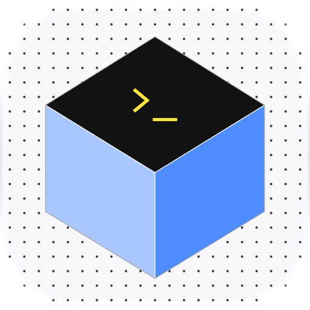

# Tugboat

**Agent Sandbox**



A macOS desktop app for running Codex and Claude Code in a shared Brig environment for each project, with a native terminal and resumable chats.

Choose a local folder and review its environment. Codex and Claude Code can use the same project files, guest processes, and network permissions. Tugboat keeps provider sign-in and renewal on the Mac.

## Features

- Add project folders, see their Git branches, and return to projects in last-opened order.
- Browse saved Codex and Claude Code sessions together, with each agent named beside its chats.
- Tugboat automatically prepares one Brig environment, network policy, and persistent guest home for each project.
- Connect ChatGPT and Claude once from Settings, before adding a project.
- Run multiple conversations per project and switch between their live terminals in the sidebar.
- Set CPU and memory limits, network mode, and allowed hosts per project. Tugboat requires image signatures.
- Check Git status, review changes, and run project tests inside the guest environment.
- Reopen completed test and diagnostic output from **Terminals** in the sidebar. The app keeps up to 32 completed terminal views for the current app session; older views are closed. **Close output** discards a view. The separate limit of 16 live processes excludes these completed views.
- Inspect Brig diagnostics, guest logs, project gateway logs, and file and network boundaries.
- Use native macOS menus and keyboard shortcuts, a fixed dark sidebar, and a light workspace.

The interface uses bundled Google Fonts Inter and Lucide sidebar icons. The native terminal uses Consolas at 14pt, with bundled Google Fonts JetBrains Mono when Consolas is unavailable. Fonts load locally.

## Requirements

- An Apple silicon Mac with macOS 15 or later.
- Internet access for the first download of guest images and boot assets.
- The bundled [Tugboat project profile](src-tauri/profiles/tugboat-project.yaml). The verified image and pinned Codex package supply both agents.
- An account with access to the selected agent. Codex uses the shared ChatGPT account; Claude Code uses the shared Claude account.

The app includes Brig v0.5.2, a patched hull CLI, signed hvi/Vz runners, cosign, and the ext4 disk tools. Brig and hull use the bundled disk tools. The hull patch also supports shared folder paths that contain spaces. Homebrew is optional.

Tugboat uses a bundled, empty registry configuration for public guest images. It does not read the host Docker credential store. Use standalone Brig for private registry sign-in. The project environment requires image signature verification.

Brig response fixtures were captured with Brig v0.5.2 and the `brig.sh/v1alpha1` format. Version records are in [config/development-versions.json](config/development-versions.json).

## Build and install

Download the Developer ID signed and Apple-notarized disk image from [GitHub Releases](https://github.com/reformo/tugboat/releases/latest). Open the disk image and drag Tugboat to Applications. If you use 0.4.0, install 0.4.1 or later from its disk image once. For subsequent releases, select **Tugboat → Check for Updates…**. See the [update procedure](docs/user-guide.html#app-update).

The trunk workflow uses the Developer ID release script to sign and notarize the app and disk image. It also signs the updater archive with a separate Tauri signing key. Follow the [release setup](docs/developer-guide.html#signed-release) for the Apple credentials, updater secrets, and public key.

The workflow validates the notarization private key before installing dependencies or preparing native tools. If notarization reports `invalidP8`, follow the [private key recovery steps](docs/developer-guide.html#invalid-apple-api-key) to replace `APPLE_API_KEY_CONTENT` from the original `.p8` file.

To build from source, install Node.js and npm, Rust and Cargo, and Xcode with its command line tools. Supported Node.js versions are 22.22.2 or later in the 22.x series, 24.15.0 or later in the 24.x series, and 26.0.0 or later. The recorded development environment uses Node.js 26.12.1 and Rust 1.99.1.

Run these commands from the project root:

```sh
npm ci
npm run tauri -- build --target aarch64-apple-darwin --bundles app
```

The build prepares the native dependencies automatically. The first build downloads pinned Ghostty, Brig, hull and e2fsprogs sources, Zig, Go, signed runners, cosign and dependency source notices. Downloaded archives are checked against their recorded SHA-256 hashes. Brig and hull release checksums also receive Sigstore signature checks. The complete host runtime is staged in `.build/brig-runtime/`. Disk tools target macOS 15 and link only to macOS system libraries.

Open the built application:

```sh
open "src-tauri/target/aarch64-apple-darwin/release/bundle/macos/Tugboat.app"
```

You can also copy `Tugboat.app` to `/Applications`.

### Releases from trunk

The release workflow runs when the latest commit of a push to `trunk` contains `new-release`. It tests and publishes four assets for that commit. The disk image supports manual installation. The updater archive, its signature, and `latest.json` support in-app updates. Each public release advances the stable version in `src-tauri/tauri.conf.json`. The tag retains the build number, and a workflow retry uses the same tag. See the [signed upgrade check](docs/developer-guide.html#verify-app-update).

## Get started

1. Open **Settings** with **⌘,**.
2. Open **Providers**. Select **Sign in with ChatGPT** or **Sign in with Claude**.
3. Complete browser authorization. Enter the ChatGPT device code shown in Settings when requested.
4. Open your project, or select **Add new project** and choose its folder.
5. Select **Open Claude Code** or **Open Codex** for the first chat. In an existing project, select the agent beside **New Chat**.
6. Select **New Chat** in an existing project. Tugboat opens the requested chat as soon as the environment and account are ready.

The project environment uses the Brig copy bundled with Tugboat. System Checks shows the runtime version and tool paths. Replace the app if a bundled tool is missing or fails its hash check.

To verify a packaged runtime, run `node scripts/release/verify-bundled-runtime.mjs /absolute/path/Tugboat.app`. The app also supports a read-only `Contents/MacOS/tugboat --runtime-check` command.

Run `npm run test:bundled-runtime -- /absolute/path/Tugboat.app` on an Apple silicon Mac to test both guests with bundled tools and system paths. Offline preflight blocks Homebrew reads and execution. Guest commands allow hvi to apply its own sandbox. The test uses a fresh private home, empty guest caches and an isolated runtime store. It checks offline tool discovery, signature verification, ext4 disks, project sharing, stop/restart and cleanup. Evidence under `artifacts/bundled-runtime/` identifies the actual host and test limits. Add `--clean-mac` to require Homebrew absence on the test host. Run `node scripts/release/package-clean-mac-test.mjs` to prepare the standalone test kit for that host.

Project actions use the registered Brig reference for the folder. They include a guest terminal, Git commands, test commands, and environment controls.

**Projects** shows registered folders in a table, ordered by last opening, with current Git branches when available. Folder paths appear in hover tooltips. Add projects only from this page. Selecting a project replaces the sidebar project list with its active Codex and Claude Code sessions. Select **Projects** to return to the library. Session names stay on one line; hover to see the full name. Drag the sidebar's right edge to resize it from its 280px minimum. The divider also supports arrow keys, Home, and End. The app saves the preferred width and keeps at least 480px for the workspace.

Each project has a fixed header with its name, branch, folder path, and Brig reference. The agent selector applies to **New Chat**. The settings icon opens the project controls. Stop the environment before changing its resource or network settings.

### Shared ChatGPT account

Manage accounts in **Settings → Providers**. Tugboat opens the official ChatGPT device page and shows its code in Settings. Codex uses the connected account in each project. The managed access copy belongs to Codex in the guest. You can sign in before adding a project.

Tugboat can use a saved project sign-in. If saved sign-ins belong to different users or workspaces, select the source project explicitly. End its existing Codex processes first. An older Codex daemon can retain credentials after its terminal closes; stop and reopen that Brig environment if Tugboat reports this condition. New chats run without this shared daemon.

The private account record is `<records folder>/chatgpt/session.json`. Its folder uses permission `0700`; the file uses `0600`. Only Tugboat renews the shared session. Guests receive access copies without the refresh token. The shared record is never mounted in a guest. Records must stay outside project folders and Brig guest homes. Custom `CODEX_HOME` locations and profile file or volume mappings are not supported for shared sign-in.

**Check connection** renews the shared session and updates its managed guest copies. **Retry connection** retries a failed transfer or renewal. Temporary failures preserve the account. If a renewal request was sent but its result is unknown, Tugboat requires another shared sign-in instead of reusing a possibly rotated refresh token. A sign-in cancelled before commitment preserves the previous account. A crash before a completed login is confirmed cancels that unfinished login on restart.

**Sign out of Tugboat** requires running Codex chats, ChatGPT sign-in processes, and Codex guest terminals to end first. It removes managed sign-in copies and reports whether remote revocation was confirmed. Removing or forgetting one project preserves the shared account for other projects. Project histories remain separate and are not deleted by account actions. Guest network policies still control model connections. Offline environments do not receive or renew access copies.

### Shared Claude account

Open **Settings → Providers** and select **Sign in with Claude**. The browser returns authorization through a temporary local callback. The same account serves managed Claude environments across projects. Sign-in does not need a project, a running guest, or a Mac Claude installation.

The private renewable record is `<records folder>/claude/session.json`, with directory permission `0700` and file permission `0600`. Tugboat owns renewal. The managed project guest receives a Claude access copy in memory. The guest helper updates that copy and preserves independent connector credentials.

Stopping an environment clears its memory copy. The shared account remains connected. Starting a chat restores the copy after checking the account and network policy. Transcripts remain in that environment's guest home. **Check connection** renews the shared account. **Sign out of Tugboat** requires Claude chats and guest terminals to end. It clears managed copies and reports unconfirmed remote revocation. Removing one environment preserves the shared account.

Claude uses the Brig boundary and manual permission requests. The Codex sandbox option does not apply to Claude. Provider authorization follows the Codex 0.167.0 and Claude Code 2.1.318 protocols. Retest browser authorization and access copies when updating guest agents.

### Chats and environments

Configured projects show saved chats and measured usage while Tugboat checks the shared environment. Tugboat checks the current plan and starts a stopped environment automatically. It reuses a verified running guest. You can inspect the plan in **Project settings**. Startup failures offer **Retry environment**. **Stop Brig environment** ends both agents’ chats and other guest processes. The persistent guest home and chat history stay available.

**New Chat** starts a process for the chosen agent inside the project environment. Selecting an open chat restores its terminal and scrollback. Claude new chats receive a UUID from Tugboat. Resume uses the saved agent and native ID. Two agents can use the same native ID and keep distinct chats.

Each root chat appears once in the session table and sidebar. Each agent’s table totals include its own usage and all linked subagents, including nested subagents. The row shows the subagent count; normal conversation forks remain separate chats. **Archived** keeps a root chat out of the active list. **Delete** moves it to **Trash**, where **Restore** returns it to the active list. These actions target that environment's chat and preserve the project total. Source Codex rollout files and Claude transcripts remain intact. End the root chat's and subagents' terminal processes before archiving or deleting the root chat. Subagents cannot be resumed, archived, deleted, or restored independently. Agents with unresolved relationships appear under **Unlinked subagents**, with read-only usage details.

### Usage and API cost

Claude rows show recorded main-session and linked subagent tokens and offer **Usage** details. Input includes ordinary input, cache reads, and cache creation. Stable message IDs prevent repeated transcript records from multiplying usage. Claude coverage remains partial because missing transcripts, unverified relationships, and unrecorded work limit the recorded total. User prompt attribution is unavailable. Supported Claude models retain Anthropic token API equivalents with dated rates and explicit billing assumptions. Mixed-project totals include recorded usage from both agents. Missing or invalid counts show **Unknown**, or a known subtotal plus **unknown**, without an exact cache percentage.

Tugboat reads Codex token events and Claude message usage from their own directories in the shared guest home. One private `usage.sqlite3` stores both agents’ session states, turns, requests, prices, corrections, and parser cursors. Requests and parser progress commit together. Dashboard reads use summaries. Details read the selected family. A chat key contains the project ID, environment ID, agent, and native session ID. Saved usage remains available if a transcript is unavailable.

The usage icon opens **Session usage**. For a root chat with subagents, **Main agent**, **Subagents**, and **Combined** separate the root's own usage from delegated work. Expand a subagent to inspect its own agent turns and requests. User prompt counts and agent turn counts are separate. Proven prompt attribution links to the source request or unmeasured turn. Work without proven attribution stays under **Unassigned to a user prompt** and remains in the selected total. A selected child's details cover that child and its descendants only; ancestors and siblings are excluded. While the dialog is open, changes in the selected subtree refresh its details and preserve open disclosures, focus, and scroll position.

Exact source ownership and parent relationships are supported for the observed guest Codex 0.167.0 format. A physical request uses the verified guest-home namespace, model provider, origin thread ID, and response ID. Different guest homes stay separate. Matching titles, token amounts, or project paths do not establish request identity. Legacy counter records retain their saved usage with unknown source coverage until reliable evidence resolves ownership; they are not reset or deduplicated by equal amounts.

The OpenAI catalogue was checked on 2026-11-17 against [OpenAI API pricing](https://developers.openai.com/api/docs/pricing). It covers GPT-6.2 Astra and Sol, GPT-6.1 Sol and Terra, and GPT-6 Astra, Sol, and Luna. Prompts above 272,000 input tokens use long-context prices for the full request. Missing tiers use Standard and carry an assumption label. GPT-6.2 Ultrafast pricing uses the request timestamp to apply the published change on March 1, 2027, Pacific time. Unverified models and tiers remain unpriced.

The Anthropic catalogue was checked on 2026-11-17 against [Claude pricing](https://platform.claude.com/docs/en/about-claude/pricing), [model IDs](https://platform.claude.com/docs/en/about-claude/models/model-ids-and-versions), [prompt caching](https://platform.claude.com/docs/en/build-with-claude/prompt-caching), and [fast mode](https://platform.claude.com/docs/en/build-with-claude/fast-mode). Explicit supported IDs cover Fable/Mythos 5, 5.1, and 5.2; Opus 4.5, 4.6, 4.7, 4.8, 5, and 5.5; Sonnet 4.5, 4.6, 5, and 5.5; and Haiku 4.5 and 5.5. Only the verified dated 4.5 snapshots and aliases are accepted. Haiku 5.5 uses its higher input and output prices above 100,000 total input tokens, including cache reads and writes. Unverified legacy long-context prices remain unpriced.

Claude ordinary input, cache reads, 5-minute writes, 1-hour writes, and inclusive output use separate token rates. Recorded standard/batch service tier, supported fast speed, and supported US inference apply Anthropic modifiers. Priority Tier and unsupported modifiers remain unpriced. Missing or nullable billing metadata uses a labelled standard-speed, standard-tier, global estimate, with 5-minute writes when the lifetime split is unavailable. Malformed non-null metadata stays unpriced and persists as invalid across restarts. Later reliable metadata can resolve assumptions using the saved tariff, while correction evidence is retained. Existing unpriced Claude records can be backfilled from saved counts without starting a guest or making an API call.

Input, cache reads, and cache writes use separate rates. Reasoning already included in output is counted once. Missing cache counts, cache-write lifetimes, and incomplete counter coverage remain explicit; unpriced requests do not become zero-cost requests. Cached input shows its share of total input in parentheses in the project total, session table, and request details. Aggregated percentages divide summed cached input by summed input; they do not average request percentages. A percentage appears only when the relevant counts are fully known. Otherwise, the UI shows **Unknown** or a known subtotal plus **unknown**. The table abbreviates large token counts, with exact counts in hover tooltips. Archived, deleted, and temporarily unavailable source sessions retain their cost history.

An agent turn without recorded request usage has unknown token counts and API cost. A recorded zero-token request is measured zero, and a history with no turns remains empty. **Recorded source coverage** can be complete, partial, or unknown. It describes the persisted records in the selected scope, not complete account billing or a guarantee that every short-lived subagent left a readable record. Pricing and cache information can remain unknown even when source coverage is complete.

These USD amounts are token API equivalents, separate from subscription charges, account discounts, server-tool charges, and taxes. They are not an invoice. Recorded supported Anthropic inference geography is included. Stored request prices do not change when a future build updates the catalogue. The reader records whether a tier came from a request, applied session settings, the turn context, or an assumption. A correction uses the original dated price snapshot and retains the previous rates and cost as evidence. It does not count the request again. Missing source files or historical rates remain explicit.

The current SQLite schema is version 2. Tugboat verifies the dataset, publishes a private empty database for new records, and advances the records marker to version 2. The database uses permission `0600` inside a private `0700` records folder.


After activation, saved Claude pricing policy version 1 runs before the first dashboard, details, or live usage read for that environment. It also runs offline. It processes selected and historical records, including unavailable and excluded records, without starting a guest or reading a transcript. Changed prices, correction evidence, summaries, and the policy version commit together. A failed commit leaves the policy pending and publishes no new price. Repeated reads skip a completed policy. Valid historical tariffs remain in use. Later source replay can attach proven identities or correct proven amounts without counting a request again. Amount corrections remain separate from rate and provider corrections.

Project registry schema 3 gives each registered folder one shared environment. The one-time reset preserves existing project registrations, project files, and provider accounts. Those projects start with empty chat history. The reset retires verified Tugboat-owned guest and chat storage and preserves external resources. Review the project plan before starting its shared environment.

**Run project tests** detects configured npm, Composer, Cargo, or pytest tests. It opens a separate terminal process while chat terminals remain available.

### Keyboard shortcuts

| Shortcut | Action |
| --- | --- |
| ⌘O | Add new project from Projects |
| ⌘, | Open Settings |
| ⌘1 | Return to the project view |
| ⌘2 | Return to the terminal |
| ⌘Q | Quit the application |

## Files and network access

The selected project folder is shared with the guest with write access. Changes made inside that folder affect the local project.

New settings use these defaults:

| Setting | Default |
| --- | --- |
| CPU count | 4 |
| Memory | 4096 MB |
| Image signature verification | Required |
| Network | Access allowed by policy |
| Allowed hosts | The default Codex and Claude host lists, combined in each new project policy |
| Brig usage telemetry | Off |

Brig network policies control connections made by guest commands and deny other destinations by default. Enter exact host names, one per line. Wildcards are not supported. Add hosts required by your project or sign-in flow.

Use **Project network policy** to change access for both agents in an existing project. Stop the shared environment before editing its policy.

**Offline** mode disables guest network access. Shared provider sign-in uses the Mac network. Online chats require isolated guest networking.

Hosted Codex tools, including web search, have a separate scope from guest command traffic. Web search can return content from an OpenAI-maintained index. Tugboat does not read or set the effective `web_search` mode and does not label it as enabled or disabled. A result from a hosted tool does not show that a guest command reached that destination. See the [official Codex configuration reference](https://learn.chatgpt.com/docs/config-file/config-reference).

New and resumed Codex chats start with `--sandbox danger-full-access --ask-for-approval never`. Codex uses Brig's file sharing and network boundaries without an additional Codex sandbox. The app also provides optional checks for the Brig boundary.

**Use the Brig boundary with the agent sandbox disabled** is selected by default. Clear it to use Codex's `workspace-write` sandbox with command network access disabled. The approval policy remains `never` in both modes.

Boundary checks target the selected environment. They select comparison hosts from its effective guest network mode and resolved policy. Offline and deny-all modes expect blocked connections. CIDR, wildcard or advanced policies remain inconclusive when a suitable comparison cannot be verified. Brig/hull host rules authorize resolved addresses, so services on shared IP addresses can have a wider scope than their host names. A reachable comparison with possible address overlap also remains inconclusive. Boundary checks report diagnostic results and do not change the selected Codex sandbox mode. See the [pinned hull network policy behavior](https://github.com/brig-sh/hull/blob/7e50ac340d69be387312755c1f07ef6b0e9fec52/docs/network-egress.md).

The installed app stores records in `~/Library/Application Support/Tugboat` by default. In **Settings → Records folder**, choose an empty folder and select **Restart Tugboat**. The project registry, settings, provider records, and closed usage database move together. Tugboat verifies the copy and commits the new location before cleaning the old records.

`Application Support/Tugboat/storage-location.json` remembers the selected folder and any pending move; a separate lock file prevents concurrent instances from changing the same records. When a custom folder is active, other Tugboat records reside there. **Use default folder** schedules a move back. Missing drives never create an empty replacement dataset. Connect the drive and restart, or use **Locate records folder…** to find the same records at a new path. Failed and interrupted moves retain the original records and retry on a later launch. Partial copies cannot be selected as active records.

Earlier directory markers are upgraded using the saved location transaction. The committed active folder remains available without changing project or settings files. Unselected older copies still require proof of completion before they can be used as active records.

The location pointer and directory marker remain outside SQLite. Settings, the project registry, profiles, installation records, and authentication storage keep their existing formats. Native transcripts and guest homes stay in their agent-owned locations. A records move stops writers, saves final usage, and closes the database before copying it. Source and target database hashes, dataset IDs, integrity, and foreign keys must match before the location pointer changes. SQLite recovers a hot rollback journal before copying; the app never deletes that journal by hand. Failed final scans, synchronization, or close operations block restart and preserve the pending move. A verified Locate operation can reconnect the same dataset at a new path and save final usage there before restart.

If an activated database is missing, damaged, replaced, or bound to another dataset, usage writes and records moves stop. The app does not create an empty replacement. Keep the entire records folder, including `usage.sqlite3-journal` if present. Reconnect the original folder through Settings, or restore a verified matching SQLite snapshot offline with a SQLite-capable build. Never copy an open database.

After an I/O or uncertain commit error, the next usage access opens a new connection to the same verified database. Identity, integrity, and committed parser progress must verify before an idempotent scan can continue. Detected corruption blocks later writes through the existing shared store.


Closing the main window, quitting with ⌘Q, or restarting Tugboat stops the running Brig environments registered to this app. If a terminal is active, **Cancel** keeps it running. When shutdown proceeds, Tugboat ends its terminal processes, saves final usage, and checks that Brig stopped each guest. If a stop fails, the app stays open and identifies the project. Opening a configured project starts its environment again with its saved files and chats.

Git commands, tests, diagnostics, policy checks, boundary checks, and **Stop Brig environment** target the selected environment. Stopping one environment preserves the other agent's environment.

**Preview environment removal…** targets the selected environment. **Preview all environments…** targets every agent environment for that project. The preview names the affected sessions, guest homes, bindings, and policies before removal. Type the displayed confirmation name to continue. Project files remain intact. If removal is interrupted, reopen the preview to continue recorded steps. Normal setup stays paused for environments with incomplete removal.

Tugboat checks project folders automatically on startup. An unavailable folder stays in the library. Connect its drive; Tugboat checks again every eight seconds while Projects is visible, and when the app regains focus. Checks pause in Settings and selected project views and stop when all folders are available. The scan preserves project records, Brig environments, saved usage, opening order, and keyboard focus. Tugboat uses the volume UUID when available to recognize a disk after a restart. Older records can recover a changed device number when the folder's inode and known creation time still match. A replaced folder or a different known volume remains unavailable.

**Forget…** removes only the Tugboat record and stops background monitoring; it preserves project files, Brig environments, guest homes and saved usage. Use **Add new project** to reconnect a moved folder instead.

## Development

Start the desktop application in development mode:

```sh
npm ci
npm run tauri -- dev
```

The command starts **Tugboat Dev** from the checkout. You can keep the installed app open. The first development run starts with an empty project list and separate provider sign-ins. Its settings and records default to `~/Library/Application Support/Tugboat Dev`. Its Brig tools use `~/.tugboat-dev` for their settings and guest data. Both versions edit the project folder you select.

The Tauri command prepares native dependencies before it starts Vite. `npm run dev` starts only the frontend server; native application features require Tauri.

### Checks

Run the frontend tests and production build:

```sh
npm test
npm run build
```

Prepare native dependencies before running Rust and native terminal tests:

```sh
npm run native:prepare
cargo test --manifest-path src-tauri/Cargo.toml --locked
npm run test:terminal
npm run test:hull
```

`npm test` covers frontend flows, Brig response fixtures, and development report calculations. The report tests use the local `reports/imp-plan.html` file and skip when it is absent.

`npm run test:terminal` checks the Ghostty terminal engine and native text composition. `npm run test:hull` checks the patched hull handling of shared folder paths.

Pull requests run frontend tests and the production web build on Ubuntu. Native changes also run Rust and native tests on the pinned Mac toolchain. This includes changes to native fixtures, runtime inputs and build scripts. These checks have read-only GitHub permissions and no publication steps. The trunk workflow retains installer publication.

Pull-request preparation uses `npm run native:prepare -- --no-sign`. This mode skips explicit signing commands and preserves vendor signature verification. Compilers can still add local ad hoc signatures. Default preparation and the Tauri build hooks retain their existing signing behavior.

The separate formatting job checks added Rust lines against `rustfmt`. It leaves existing format differences unchanged. Run `python3 scripts/check-rust-format.py <base-commit>` to check committed changes against a base commit. Optional local report checks and unavailable disk-tool checks give their skip reasons in the test output.

### SQLite usage verification

The SQLite acceptance and performance checks use generated records and native transcripts. They do not launch Tugboat or use account data. Keep the frozen P01 JSON source and its manifest for the comparison build. The local results are linked from `reports/sqlite-usage-migration-plan.html`.

The macOS signature test in `npm test` signs a temporary copy of `/usr/bin/true`. Skip that test when signing is prohibited. Native dependency preparation and ordinary Tauri packaging also have signing steps; do not use them in a no-sign verification run. Set `P06_TEST_BINARY` and `P01_TEST_BINARY` to the recorded current and frozen Rust test executables. Set `P06_CARGO_TARGET` to the recorded temporary Cargo target directory. With verified native dependencies already cached, use:

```sh
cargo fmt --manifest-path src-tauri/Cargo.toml -- --check
cargo test --manifest-path src-tauri/Cargo.toml --locked
node --experimental-vm-modules --test --test-skip-pattern='^codesign evaluates the Developer ID requirement against an ad hoc signature$' tests/*/*.test.mjs
npm run build
python3 scripts/check-sqlite-usage-acceptance.py --binary "$P06_TEST_BINARY" --old-binary "$P01_TEST_BINARY" --output reports/sqlite-usage-evidence/p06/append-remediation/acceptance/final
python3 scripts/compare-sqlite-frozen-contracts.py --sql-cache "$P06_CARGO_TARGET" --output reports/sqlite-usage-evidence/p06/append-remediation/acceptance/frozen-build-parity
python3 scripts/benchmark-sqlite-usage.py --warmups 5 --repetitions 100 --fixture-parent /private/tmp --evidence-dir reports/sqlite-usage-evidence/p06/append-remediation/performance
python3 scripts/check-sqlite-usage-volume.py
```

The volume check creates and removes its temporary APFS disk image. The performance check compares optimized Rust workers on the same local volume. It measures database seeding, saved Claude pricing, and later opens separately. Interruption tests use temporary records.

The frozen-build check injects its shared export adapter only into disposable source copies. Both builds read the same generated native files, paths, and inodes. It compares complete dashboard, details, event, resume, quiet-poll, and state-transition results for Codex and all three Claude contracts. It fixes only the transport sequence. It also compares typed ledgers, prices, and ordered corrections.

For unsigned native verification, use the recorded P06 build route with `--no-sign --no-binary-patching`, a null signing identity, and the final linker’s `-no_adhoc_codesign` option. Verify that the app has no `_CodeSignature` directory and its main binary has no `LC_CODE_SIGNATURE`. Do not launch the app against active records as part of these checks.


Run the isolated, real Brig CLI environment check after preparing native dependencies:

```sh
node scripts/acceptance/check-shared-project.mjs
```

This check creates one disposable guest with a shared home, a deny-by-default policy, and two explicitly selected agent programs. It verifies the signed image, project and guest-home mounts, restart, and cleanup. The runner prints the temporary evidence path. Use the native setup check to verify the application preparation route. See the [shared project guest proof](docs/shared-project-proof.html).

### Application icon

The logo source is [src-tauri/icons/brig-desktop.svg](src-tauri/icons/brig-desktop.svg). Rebuild the native macOS icon assets with:

```sh
npm run icon:build
```

This command requires Xcode with Icon Composer. Rebuild the app bundle to include the updated assets.

### Project layout

| Path | Purpose |
| --- | --- |
| [src/](src/) | TypeScript interface. `main.ts` connects the features; `app/` owns startup and application state. |
| [src/projects/](src/projects/), [src/providers/](src/providers/), [src/settings/](src/settings/) | Project selection and operations, provider accounts, and application preferences |
| [src/dashboard/](src/dashboard/), [src/usage/](src/usage/), [src/terminal/](src/terminal/), [src/sidebar/](src/sidebar/) | Dashboard state, usage details, terminal controls, and sidebar behavior. [src/ui/](src/ui/) holds shared interface helpers. |
| [src-tauri/src/](src-tauri/src/) | Rust application. `main.rs` registers commands. `desktop/` owns startup, settings, menus, and shutdown. `platform/` runs and inspects host tools. |
| [projects](src-tauri/src/projects/), [environment](src-tauri/src/environment/), [agents](src-tauri/src/agents/), [agent_sessions](src-tauri/src/agent_sessions/), [providers](src-tauri/src/providers/), [terminal](src-tauri/src/terminal/) | Project records and policy, environment preparation, agent commands and launches, provider accounts, and native terminal sessions |
| [conversations](src-tauri/src/conversations/), [usage](src-tauri/src/usage/), [usage_store](src-tauri/src/usage_store/), [storage](src-tauri/src/storage/) | Conversation history, usage calculation, SQLite persistence, and record files and their location |
| `src-tauri/native/` | Native macOS terminal view and input handling |
| `src-tauri/icons/` | Logo sources and application icon assets |
| [scripts/](scripts/) | Node tools are grouped under `runtime/`, `acceptance/`, `licenses/`, `release/`, and `reports/`. |
| `config/` | Dependency versions and hull build configuration |
| [tests/](tests/) | Node suites are grouped by feature. Shared inputs remain in `fixtures/`. Rust unit tests live with their owning modules. |
| `resources/` | Runtime patches, bundled assets, and manually maintained license notices |

[PRODUCT.md](PRODUCT.md) describes the product scope. [DESIGN.md](DESIGN.md) records the interface rules.

## Third-party notices

The build generates `Tugboat.app/Contents/Resources/licenses/THIRD-PARTY-NOTICES.txt`. Its index maps each component and version to its full notice texts. Components with identical texts share one copy.

The adjacent `sources/e2fsprogs/` folder contains the exact source archive, build instructions, build script, and version information for the bundled disk tools. The Brig patch and its source information are in `sources/brig/`.

Tauri generates these files before each bundle. To regenerate them separately, run `npm run native:prepare` and then `npm run licenses:bundle`. Output goes to `.build/licenses/`. Git keeps the [curated notice inputs](resources/license-supplements/) and the build scripts.

The hull modification is recorded in [config/hull-compat.json](config/hull-compat.json). Its patch is in [resources/runtime/hull-spaces.patch](resources/runtime/hull-spaces.patch).

## Technologies

| Technology | Role |
| --- | --- |
| Tauri 2 | Desktop application framework and frontend-to-native commands |
| Rust | Application backend, process control, settings, and Brig integration |
| TypeScript | Frontend behavior and typed application commands |
| Vite | Frontend development server and production build |
| HTML and CSS | Application interface and system appearance |
| Objective-C, AppKit, and Core Text | Native terminal view, text rendering, input, and clipboard integration |
| libghostty-vt | Terminal emulation and terminal state |
| Brig, hull, and hvi/Vz | Guest environments, execution plans, and network policies |
| Node.js and npm | Frontend dependencies, build scripts, and tests |
| Zig and Go | Pinned toolchains for building Ghostty and hull |
| Swift and Icon Composer | Native macOS icon generation |
| jsdom and the Node.js test runner | Frontend and report tests |
