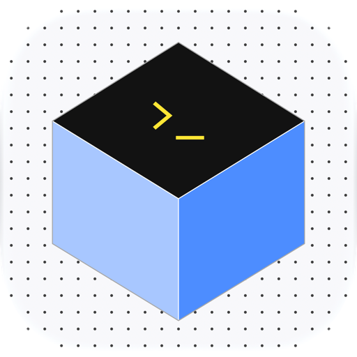

# Tugboat

**Agent Sandbox**



A macOS desktop app for running Codex in Brig sandboxes, with a native terminal, resumable sessions, and per-project network controls.

Choose a local project folder, prepare a Brig environment, and work with Codex in the app. The terminal supports interactive conversations and approval requests.

## Features

- Add project folders, see their Git branches, and return to projects in last-opened order.
- Browse saved Codex sessions for the selected project in the sidebar.
- Prepare project policies and session bindings automatically, or use a matching Brig session.
- Sign in with ChatGPT inside the guest environment.
- Run multiple Codex conversations per project and switch between their live terminals in the sidebar.
- Set CPU and memory limits, image verification, and allowed network hosts.
- Check Git status, review changes, and run project tests inside the guest environment.
- Inspect Brig diagnostics, logs, and file and network boundaries.
- Use native macOS menus and keyboard shortcuts, a fixed dark sidebar, and a light workspace.

The interface uses bundled Google Fonts Inter and Lucide sidebar icons. The native terminal uses Consolas at 14pt, with bundled Google Fonts JetBrains Mono when Consolas is unavailable. Fonts load locally.

## Requirements

- An Apple silicon Mac with macOS 15 or later.
- The Brig CLI and a working `hvi` runtime setup.
- A Brig agent profile that runs Codex. The default profile name is `codex`.
- A ChatGPT account with access to Codex.

The app includes a modified `hull` CLI. Brig and the `hvi`/Vz runners remain external dependencies. The modification supports shared folder paths that contain spaces.

Brig response fixtures were captured with Brig v0.5.2 and the `brig.sh/v1alpha1` format. Version records are in [config/development-versions.json](config/development-versions.json).

## Build and install

Install Node.js and npm, Rust and Cargo, and Xcode with its command line tools. The recorded development environment uses Node.js 26.12.1 and Rust 1.99.1.

Run these commands from the project root:

```sh
npm ci
npm run tauri -- build --target aarch64-apple-darwin --bundles app
```

The build prepares the native dependencies automatically. The first build downloads pinned Ghostty sources, Zig, hull sources, and Go. Downloaded archives are checked against their recorded SHA-256 hashes. Native build files are cached in `.build/`.

Open the built application:

```sh
open "src-tauri/target/aarch64-apple-darwin/release/bundle/macos/Tugboat.app"
```

You can also copy `Tugboat.app` to `/Applications`. Local builds use ad hoc signing.

## Get started

1. Open **Settings** with **⌘,**.
2. Select **Check this Mac** to inspect the installed tools and Brig diagnostics.
3. Set the Brig CLI path if automatic detection fails.
4. Review the Codex profile, resource limits, image verification, and network settings.
5. Open **Projects** and select **Add new project** or **⌘O**.
6. Open the project's settings icon and review its resource limits, network, and **Sharing and execution plan**.
7. Select **Prepare environment** to start the guest and check its Codex version.
8. Select **Sign in with ChatGPT** in project settings. Complete device sign-in in your Mac browser.
9. Select **Check sign-in status**.
10. Close project settings and select **New Chat**, or select a saved session from the project table or sidebar.

If Brig is missing, Settings offers **Install Brig with Homebrew**. This action updates Homebrew, adds and trusts the `brig-sh/brig` tap, and installs Brig. Install Homebrew first if it is unavailable.

When several Brig sessions match a folder, select the session to use. Project actions also provide a guest terminal, Git commands, test commands, and session controls.

**Projects** shows registered folders in a table, ordered by last opening, with current Git branches when available. Folder paths appear in hover tooltips. Add projects only from this page. Selecting a project replaces the sidebar project list with its active Codex sessions. Select **Projects** to return to the library. Session names stay on one line; hover to see the full name. Drag the sidebar's right edge to resize it from its 280px minimum. The divider also supports arrow keys, Home, and End. The app saves the preferred width and keeps at least 480px for the workspace.

Each project has a fixed header with its name, branch, and `folder path · Brig session` line. Its settings icon opens a wide modal for project name, CPU, memory, image verification, network, sign-in, policy, and environment actions. Project resource options override the app defaults and persist with the project. Stop the environment before changing them. The dot grid appears only in the Projects library.

Ready projects show saved sessions, token totals, and API cost equivalents. **New Chat** starts another Codex process in the project's Brig environment. Selecting an open chat in the sidebar restores its existing terminal and scrollback. Other chats continue running. A spinning activity icon precedes a session while its agent is working or thinking. End process closes the selected terminal. **Archived** keeps chats out of the active list. **Delete** moves a chat to **Trash**, where **Restore** returns it to the active list. These states belong to Tugboat; source Codex rollout files remain intact. Archive and deletion preserve all historical usage in the project total. End a session's terminal before archiving or deleting that session. Prepare a stopped environment before resuming a saved session.

### Usage and API cost

Tugboat reads token events from the selected guest home's Codex rollout files. A background reader checks observed projects every two seconds and writes an atomic project ledger under `conversation-ledgers/` in the app configuration directory. Each prompt retains its request counts, completion or interruption state, model, price snapshot, and cumulative cost. The usage icon on each session opens the prompt breakdown. Prompts and answers are not copied into this ledger.

The bundled price snapshot was verified on 2026-11-10 against [OpenAI API pricing](https://developers.openai.com/api/docs/pricing), [GPT-6.1 Sol pricing](https://developers.openai.com/api/docs/models/gpt-6.1-sol), and [prompt caching](https://developers.openai.com/api/docs/guides/prompt-caching). It covers GPT-6 Astra, GPT-6.1 Sol, GPT-6.1 Terra, and GPT-6 Luna. Supported recorded service tiers apply their published multiplier; missing tiers use Standard and are labelled as assumed. Sol requests above 272K input tokens use the published full-request long-context rates. Other unverified models, tiers, or long-context rates remain unpriced.

Input, cache reads, and cache writes use separate rates. Reasoning already included in output is counted once. Missing cache counts, cache-write lifetimes, and incomplete counter coverage remain explicit; unpriced requests do not become zero-cost requests. Cached input shows its share of total input in parentheses in the project total, session table, and request details. The table abbreviates large token counts, with exact counts in hover tooltips. Archived, deleted, and temporarily unavailable source sessions retain their cost history.

These USD amounts are API equivalents, separate from ChatGPT subscription billing, tools, taxes, and regional premiums. Imported history uses the bundled price snapshot on first import. Stored request prices do not change when a future build updates the catalogue.

**Run project tests** detects configured npm, Composer, Cargo, or pytest tests. It opens a separate terminal process while the Codex terminal remains available.

### Keyboard shortcuts

| Shortcut | Action |
| --- | --- |
| ⌘O | Add new project from Projects |
| ⌘, | Open Settings |
| ⌘1 | Return to the project view |
| ⌘2 | Return to the terminal |
| ⌘Q | Quit the application |

## Files and network access

The selected project folder is shared with the guest with write access. Changes made inside that folder affect the local project.

New settings use these defaults:

| Setting | Default |
| --- | --- |
| CPU count | 4 |
| Memory | 4096 MB |
| Image signature verification | Required |
| Network | Access allowed by policy |
| Allowed hosts | `auth.openai.com`, `chatgpt.com`, `api.openai.com` |
| Brig usage telemetry | Off |

Network policies deny other destinations by default. Enter exact host names, one per line. Wildcards are not supported. Add hosts required by your project or sign-in flow.

The allowed hosts in Settings apply to new policies. Use **Project network policy** to inspect or change an existing project's policy. Stop the environment before editing its allowed hosts.

**Offline** mode disables guest network access. Online Codex sessions and sign-in require network access.

Codex starts with `workspace-write` sandboxing, command network access disabled, and `on-request` approvals. The app also provides checks for the outer Brig boundary.

The optional **Use the Brig boundary with the Codex sandbox disabled** mode requires current Brig boundary checks to pass. It gives commands more access inside the guest. Approvals remain `on-request`.

Settings and recent project records are stored in the app's macOS configuration directory. Brig manages guest homes and conversation history. Closing the app while a process runs asks for confirmation. Cancel keeps the app and process open. Confirming ends open terminal processes and preserves Brig environments, guest homes, and conversation history.

Use **Stop Brig environment** to stop a guest. Use **Preview removal…** to review session removal and confirm its name.

## Development

Start the desktop application in development mode:

```sh
npm ci
npm run tauri -- dev
```

The Tauri command prepares native dependencies before it starts Vite. `npm run dev` starts only the frontend server; native application features require Tauri.

### Checks

Run the frontend tests and production build:

```sh
npm test
npm run build
```

Prepare native dependencies before running Rust and native terminal tests:

```sh
npm run native:prepare
cargo test --manifest-path src-tauri/Cargo.toml --locked
npm run test:terminal
npm run test:hull
```

`npm test` covers frontend flows, Brig response fixtures, and development report calculations. The report tests use `imp-plan.html`.

`npm run test:terminal` checks the Ghostty terminal engine and native text composition. `npm run test:hull` checks the patched hull handling of shared folder paths.

### Application icon

The logo source is [src-tauri/icons/brig-desktop.svg](src-tauri/icons/brig-desktop.svg). Rebuild the native macOS icon assets with:

```sh
npm run icon:build
```

This command requires Xcode with Icon Composer. Rebuild the app bundle to include the updated assets.

### Project layout

| Path | Purpose |
| --- | --- |
| `src/` | TypeScript frontend and styles |
| `src-tauri/src/` | Rust application commands, project state, and Brig integration |
| `src-tauri/native/` | Native macOS terminal view and input handling |
| `src-tauri/icons/` | Logo sources and application icon assets |
| `scripts/` | Native dependency preparation, checks, and build tools |
| `config/` | Dependency versions and hull build configuration |
| `tests/` | Frontend tests, Brig fixtures, and native tests |
| `resources/` | Runtime patch and dependency license texts |

[PRODUCT.md](PRODUCT.md) describes the product scope. [DESIGN.md](DESIGN.md) records the interface rules.

## Third-party notices

Bundled dependency notices and license texts are in [resources/licenses/](resources/licenses/). These files are included in the application bundle.

The hull modification is recorded in [config/hull-compat.json](config/hull-compat.json). Its patch is in [resources/runtime/hull-spaces.patch](resources/runtime/hull-spaces.patch).

## Technologies

| Technology | Role |
| --- | --- |
| Tauri 2 | Desktop application framework and frontend-to-native commands |
| Rust | Application backend, process control, settings, and Brig integration |
| TypeScript | Frontend behavior and typed application commands |
| Vite | Frontend development server and production build |
| HTML and CSS | Application interface and system appearance |
| Objective-C, AppKit, and Core Text | Native terminal view, text rendering, input, and clipboard integration |
| libghostty-vt | Terminal emulation and terminal state |
| Brig, hull, and hvi/Vz | Guest environments, execution plans, and network policies |
| Node.js and npm | Frontend dependencies, build scripts, and tests |
| Zig and Go | Pinned toolchains for building Ghostty and hull |
| Swift and Icon Composer | Native macOS icon generation |
| jsdom and the Node.js test runner | Frontend and report tests |
